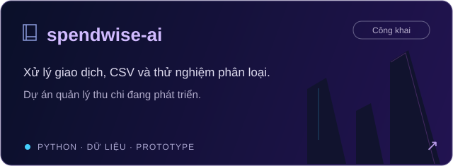
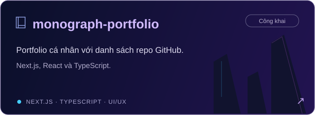
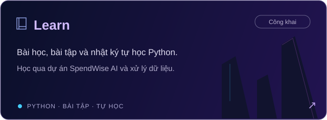
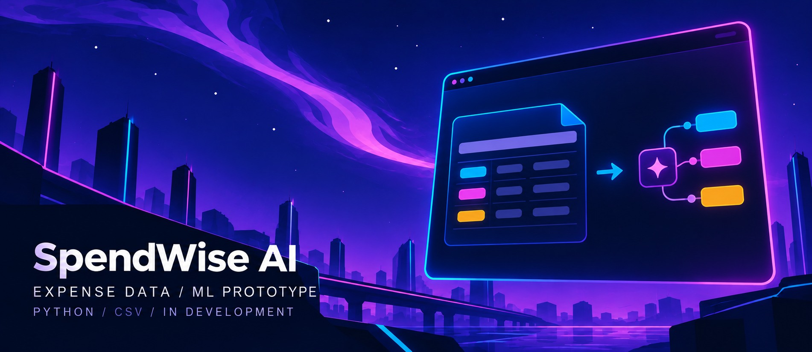
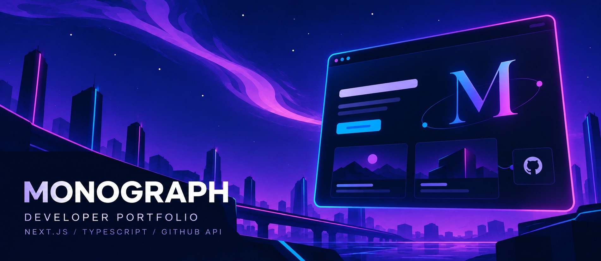

  

<h1 align="center">Good design. Clear purpose. Better websites.</h1>

  Hi, I'm <strong>Tri (Krev1)</strong>, a web developer based in <strong>Ho Chi Minh City, Vietnam</strong>. 
  I build websites for small and medium-sized businesses — to showcase services, 
  connect with customers, and bring online stores to life.

  
  
  

Web development &nbsp; / &nbsp; Web design &nbsp; / &nbsp; Shopify &nbsp; · &nbsp; Rising Talent on Upwork

## Kho mã nổi bật

Các kho mã công khai của mình trên GitHub. Nhấn vào từng thẻ để xem nội dung.

  
  

  
  

- **SpendWise AI:** đã có công cụ giao dịch/CSV, xử lý dữ liệu và prototype baseline phân loại. Ứng dụng web đầy đủ và pipeline huấn luyện ML vẫn đang phát triển.
- **MONOGRAPH:** portfolio cá nhân bằng Next.js, React và TypeScript; giới thiệu dự án, liên hệ và lấy danh sách repo công khai từ GitHub API.
- **Learn:** lộ trình, bài học, bài tập và nhật ký Python; có tài liệu thực hành CSV, gán nhãn và xây dựng dataset cho SpendWise AI.

[Xem tất cả kho mã →](https://github.com/Krev1?tab=repositories)

 

## Selected work

Product pages, ecommerce, and development tooling — selected projects and contributions.

### 01 / AppShare

**AppShare Product Landing Page Website**  
A product landing page website, featured in my Upwork portfolio.

`Web Design` &nbsp; `Web Development`  
[View my portfolio on Upwork ↗](https://www.upwork.com/freelancers/~011c3300901128f074)

 

### 02 / Shopify Theme Reconstruction

**Shopify Theme Reconstruction · Baseline / Strike styles**  
A Shopify theme implementation for a streetwear storefront, developed through multiple demo and final archive versions. The supplied source includes **58 Liquid section files** and separate Baseline-style and Strike-style homepage templates.

- **Storefront design:** configurable sections, product walls, featured menus, collection carousels, and scrolling announcements.
- **Shopping interactions:** product quick view, variant selection, image gallery, cart drawer, and search drawer.
- **Store pages:** product, collection, cart, blog, article, contact, policy, and customer account templates.
- **Theme customization:** section settings and configurable color schemes.

Implementation details verified from the supplied archives. A public code repository or unrestricted live demo has not been provided.

`Shopify Liquid` &nbsp; `CSS` &nbsp; `JavaScript` &nbsp; `JSON Templates`  
[View my portfolio on Upwork ↗](https://www.upwork.com/freelancers/~011c3300901128f074)

 

### 03 / ProZ0 · Development tooling contribution

A contribution to **ProZ0**, a browser-based pixel-art survival and exploration game. My local work includes an **audio audition harness**, browser tooling fixes, and documentation for audio comparison and review gates.

**Contribution:** development and audio review tooling.  
**Project stack:** TypeScript · PixiJS · Vite · Vitest · Playwright.  
[Explore the project ↗](https://github.com/5erax/ProZ0)

 

### 04 / SpendWise AI

**SpendWise AI · Dự án đang phát triển**  
Dự án quản lý thu chi và nghiên cứu phân loại mô tả chi tiêu tiếng Việt. Nội dung hiện có gồm công cụ giao dịch/CSV, xử lý và chia dữ liệu, prototype baseline cùng tài liệu và kiểm thử.

Ứng dụng web đầy đủ và pipeline huấn luyện ML chưa hoàn thành. Thumbnail là minh họa luồng dữ liệu, không phải ảnh ứng dụng đã triển khai.

`Python` &nbsp; `CSV` &nbsp; `Data Processing` &nbsp; `ML Prototype`  
[Xem mã nguồn ↗](https://github.com/Krev1/spendwise-ai)

 

### 05 / MONOGRAPH Portfolio

**MONOGRAPH · Developer Portfolio**  
Portfolio cá nhân với các phần giới thiệu, dự án và liên hệ, xây dựng bằng Next.js, React và TypeScript. Danh sách kho mã công khai được lấy từ GitHub API.

`Next.js` &nbsp; `React` &nbsp; `TypeScript` &nbsp; `GitHub API`  
[Xem mã nguồn ↗](https://github.com/Krev1/monograph-portfolio)

 

### 06 / Learn · Python Learning Journey

**Learn · Hành trình tự học Python**  
Kho bài học, bài tập, lộ trình và nhật ký tự học. Có nội dung học qua dự án SpendWise AI, thực hành CSV, gán nhãn và xây dựng dataset.

`Python` &nbsp; `Self-study` &nbsp; `Data Practice`  
[Xem bài học và bài tập ↗](https://github.com/Krev1/Learn)

 

Project covers are original illustrations, not screenshots. ProZ0 is presented as a contribution.

## What I can help with

| Your goal | My focus |
| :--- | :--- |
| **Introduce your business** | Websites that present your business and services. |
| **Showcase a product** | Product landing pages and web design. |
| **Start an online store** | Ecommerce websites, Shopify development, and Shopify website design. |
| **Build for the web** | Website and web application development. |

 

## Behind the work

  
  
  
  
  

| Focus | Skills |
| :--- | :--- |
| **Web foundations** | HTML · CSS · JavaScript |
| **Programming** | Python |
| **Ecommerce** | Shopify · Shopify Development · Shopify Website Design |
| **Design & development** | Web Design · Web Development · Web Application |
| **Working together** | Clear communication · Attention to detail |

  
<strong>A little more about me</strong>

 

<ul>
  <li>Based in <strong>Ho Chi Minh City, Vietnam</strong>.</li>
  <li>Focused on websites for <strong>small and medium-sized businesses</strong>.</li>
  <li>My work spans <strong>business websites, product landing pages, and online stores</strong>.</li>
  <li>Find my portfolio and professional profile on <a href="https://www.upwork.com/freelancers/~011c3300901128f074">Upwork</a>.</li>
</ul>

 

  Have a business, a product, or a store to bring online? 
  <strong>Let's talk about your website.</strong>

  

